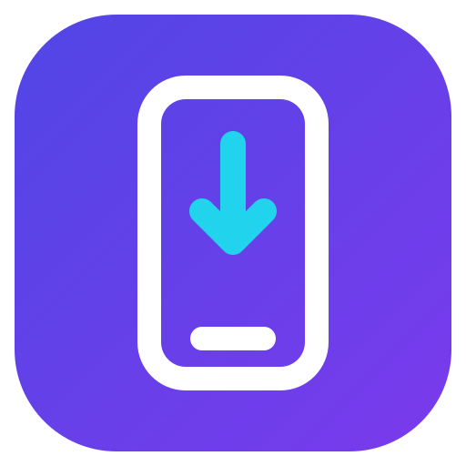
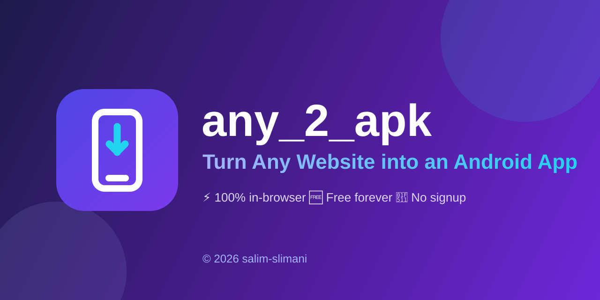

<p align="center">
  
</p>

# any_2_apk — Turn Any Website into an Android App

<p align="center">
  
</p>

**Live site:** https://salim-studio.github.io/any_2_apk/

Enter any website URL and download a complete Android (WebView) project — ready to build into an APK. The web version runs 100% in the browser (JSZip): nothing is uploaded, no signup.

## How to get your APK (pick one)

1. **Free cloud build (easiest):** upload the ZIP contents to a new GitHub repo → `Actions` tab → download `app-debug.apk` (a workflow is included).
2. **Local build:** open the project in Android Studio → Run, or `./gradlew assembleDebug`.
3. **Instant alternative:** paste the same URL into PWABuilder.com.

## Run locally (static site)

Just open `index.html` in a browser — no server needed.

## Run the Flask version (optional)

```
pip install -r requirements.txt
python app.py
```

Then open http://localhost:5000

## Honest note

No tool can convert Windows `.exe` programs directly into APKs. The correct paths are wrapping the web version (this tool) or rebuilding natively with Kotlin / Flutter.

---
© 2026 salim-slimani. All rights reserved.
